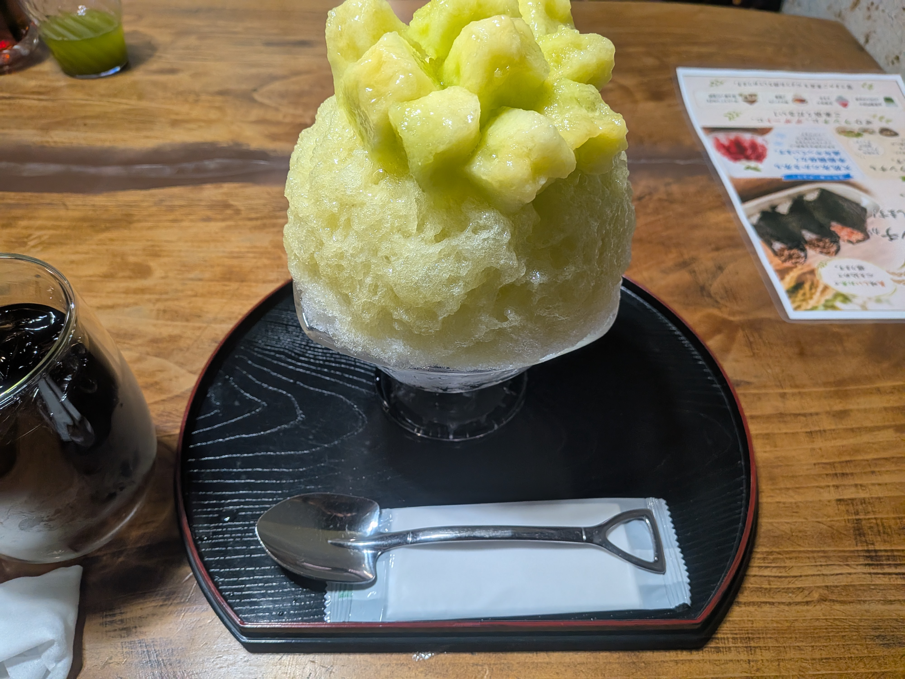
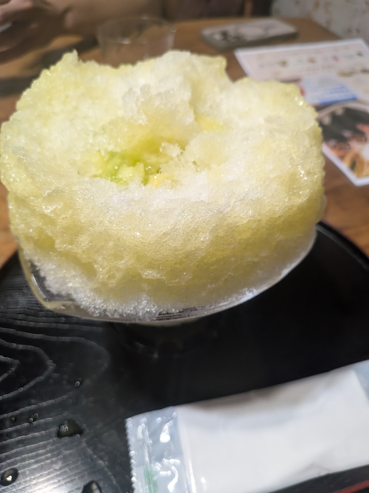

## 今日やったこと

- **高級かき氷を体験**

## かき氷

友人数名と一緒に[とろりん茶房 香茶喜縁](https://www.tororin-sabou.jp/)へ行き、皆でかき氷を食べました。

私は **ゴロっと！生メロン** 味を頼みました。今まで人生で食べたことのある最も高級なかき氷はファミレスのデザートメニュー程度だったので、正直2000円超をかき氷に払う価値があるのか？と疑問に思っていたのですが、いざ提供されるとその勘繰りは良い意味で覆されました。

崩れるギリギリまで氷の上にメロン果肉が大量に乗っており、 **氷に対する味付けとメロンそのものの味を同時に楽しめる** 設計になっていました。一口食べるとメロン本来の自然な甘味と氷の冷たさが口いっぱいに広がりました。

トレーの上にこぼしてしまわないよう果肉を優先的に食べ進め、このままだと残りは氷だけになってしまうな……と思っていたところ、

なんと **かき氷内部にもメロン果肉が配置されている** ことに気付きました。これにより最後の一口まで一切味がダレることなく、完璧なバランスが保たれました。

人生最高のかき氷体験となり、「高級かき氷」というジャンルが成立する理由を身体で理解することができました。 ~~これに比べたら自宅で作るかき氷はカスや。~~