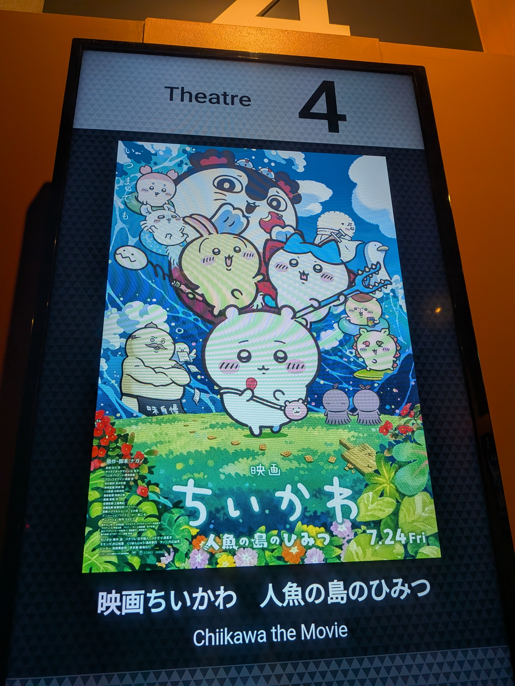

## 今日やったこと

- サークル対面活動
- **ちいかわ映画鑑賞**

## ちいかわ映画

知人と都合を合わせてレイトショーでちいかわの映画を観に行きました。

以前より「島編」を映画化した内容であることは告知されていました。実は、 **ちょうどX(旧Twitter)で島編が更新されていた時期が私の浪人期と重なっています。** 勉強の合間に最新話を追うことが息抜きとして助けられていた面もあり、個人的に記憶に残っているストーリーです。

とはいえ約3年前の内容ということもあり、流石にぼやけつつある記憶を頼りに臨んだのですが、いざ始まると当時の記憶が鮮明に蘇ってきて謎に懐かしさが込み上げてきました。

今後観に行きたい人もいると思うので根本的なネタバレは控えますが、全体的にアニオリ展開はほぼなく、原作を忠実に映像化している印象です。X(旧Twitter)上では「子供向けだと思ってそうなファミリーが上映後に～～～」といった露悪的な感想も目立ちますが、「罪に対してどう対峙するか」「他人の秘密を得たときどうするか」といったテーマは **情操教育として成立しうる内容** だと思います。

あとはとにかく **セイレーンの造形が可愛すぎ、萌えすぎ** ました。 ~~私もちいかわみたいにセイレーンの尾を枕代わりにして寝たすぎます。~~