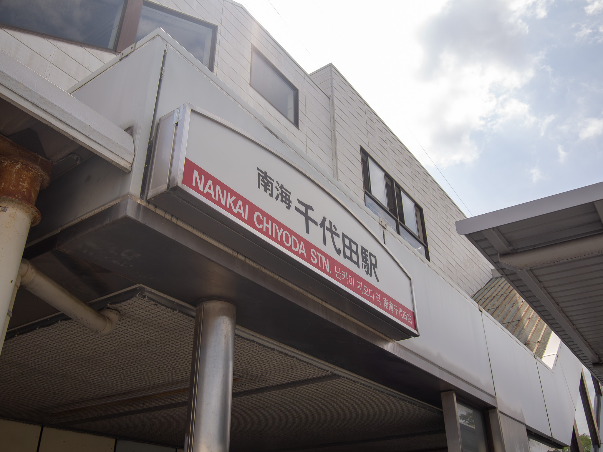
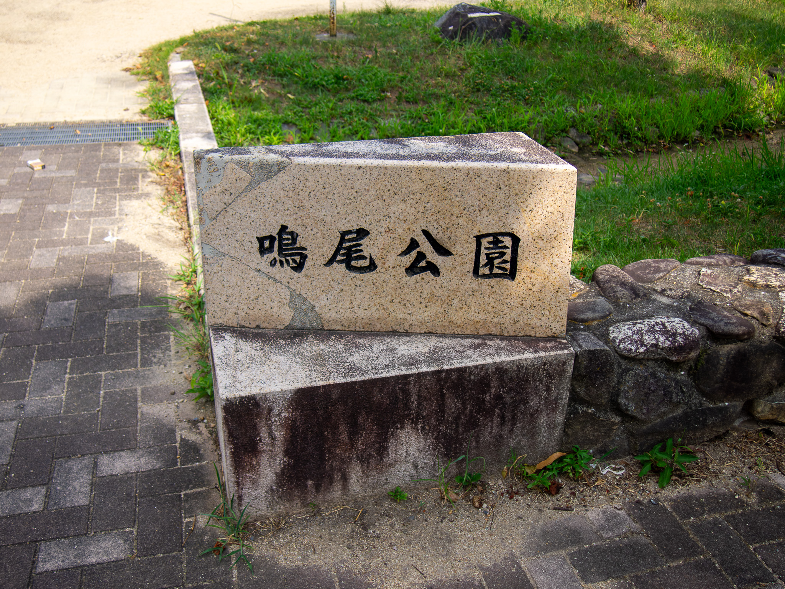
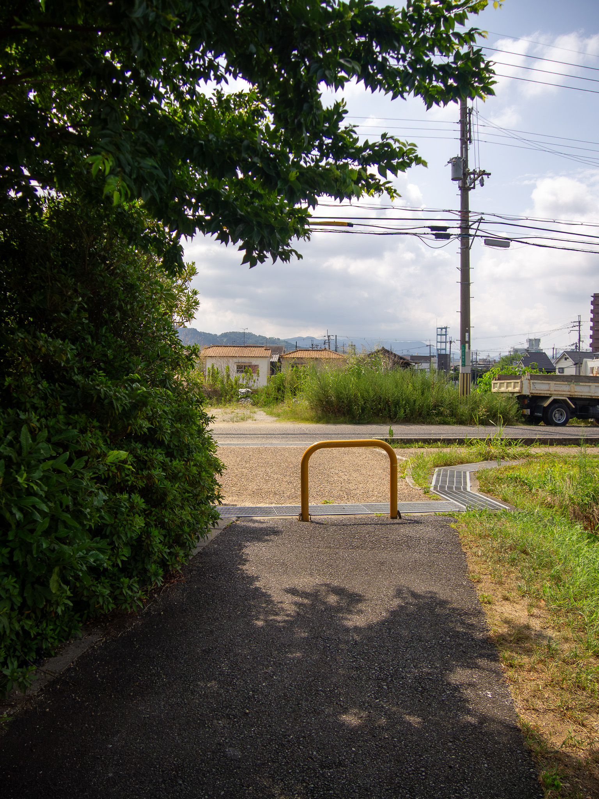

## 今日やったこと

- **弾丸大阪・奈良旅行**

## 大阪に到着

7時過ぎに夜行バスが大阪に到着し、シャワーを浴びて早速聖地巡礼に向かいました。

秘封倶楽部の最新作である **『霊長新益京』** の（予想される）聖地は奈良の藤原京ですが、一旦それは置いといて **まずは”とあるネットミーム”の聖地に行くことにしました。**

## 21歳最後の抵抗

大阪南部、聖地の最寄り駅である南海千代田駅に到着し、10分ほど歩きました。

強い日差しが照りつける中、日焼け止めを持ってくればよかったと思いつつ黙々と進むと、閑静な住宅街の中に位置する……

**鳴尾（どんど）公園** に到着しました。公園の名前を聞いただけでは、まだピンとこない読者の方が大半だと思います。

詳細な位置関係については調べていませんでしたが、少し公園内を探してみると容易に作中スポットが見つかりました。

インターネットの皆さんなら、流石にもう理解できたでしょうか。

そう、 **あの[「拳で抵抗する21歳」](https://dic.nicovideo.jp/a/%E6%8B%B3%E3%81%A7%E6%8A%B5%E6%8A%97%E3%81%99%E3%82%8B21%E6%AD%B3)が撮影された場所** です。

私は現在21歳で、8月10日に誕生日を迎えることとなります。どうしても21歳のうちに訪れたいと以前から思っており、今回こうして悲願が叶うこととなりました。

当時私と同じ歳だった男がここで抵抗の意志を示したのだと思うと、なんだか感慨深い気持ちになりました。

*――彼と同じ状況に立たされたとき、私は拳を示せるでしょうか？*

## 奈良へ

ひとしきり感慨にふけった後、本題の「秘封倶楽部の予想聖地巡礼」を行うために奈良の藤原京跡へ向かいました。奈良の中心部から離れていることもあり、公共交通機関があまり整備されていなかったので駅からはかなり歩くことになりました。ケチって徒歩を貫きましたが、タクシーを使えばよかったかもしれません。

その後は北上し、奈良公園や東大寺など楽曲タイトルから関連が予想されるスポットを巡っていきました。

具体的な内容に関しては **秋例大祭でツクテリアが刊行予定の部誌** に載せようと思うので割愛させてください。

## 帰還

日没頃に大阪の日本橋に向かい、オタロードを1時間ほど観光しました。なんだかんだ日本橋が **旅程を通して最も落ち着く場所** でした。オタクなので……

かなり突発的に始めた弾丸旅行だったので旅行プランなどあってないようなものだったのですが、いざ蓋を開けてみると「大阪市中央→鳴尾公園→藤原京跡→奈良市内（その他東方聖地）→大阪市」と反時計回りでうまく巡ることができました。

8時過ぎに夜行バスに乗り込み、こうして1日の旅行が終わりを迎えました。